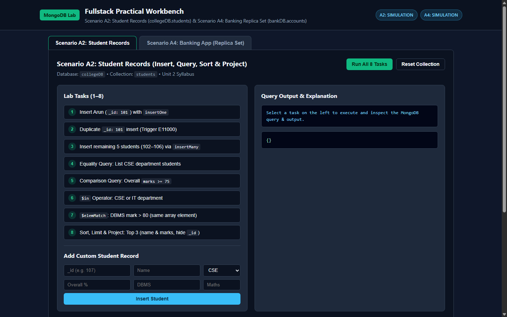

# MongoDB Lab Practicals — Fullstack JavaScript Project

A unified **Node.js + Express + MongoDB + Vanilla JS** fullstack web application covering both MongoDB lab practical scenarios:

1. **Scenario A2 — Student Records (`collegeDB.students`)**: `insertOne`, duplicate `_id` (`E11000`) error handling, `insertMany`, equality queries, comparison operators (`$gte`), `$in`, `$elemMatch` on nested `scores` arrays, sorting, limiting, and projection.
2. **Scenario A4 — Banking App Replica Set (`bankDB.accounts`)**: 3-node replica set (`rs0` on ports `27017`, `27018`, `27019`), `rs.initiate()`, Primary/Secondary identification, `w: "majority"` write concern, `secondaryPreferred` read preference, `local.oplog.rs` inspection, `rs.stepDown()` failover election, and `rs.status()` replication lag monitoring.

---

## Project Structure

```text
mongodb-lab-fullstack/
├── .env.example
├── .gitignore
├── package.json
├── README.md
├── server.js                              # Express server (Live MongoDB + Simulation fallback)
├── routes/
│   ├── students.js                        # Scenario A2 API endpoints (Tasks 1–8 + custom insert)
│   └── banking.js                         # Scenario A4 API endpoints (Tasks 1–7)
├── scripts/
│   ├── scenario-a2-students.mongosh.js    # Standalone mongosh script for Scenario A2
│   ├── scenario-a4-banking.mongosh.js     # Standalone mongosh script for Scenario A4
│   ├── start-replica-set.sh               # Linux/macOS 3-node rs0 startup script
│   └── start-replica-set.bat              # Windows 3-node rs0 startup script
└── public/
    ├── index.html                         # Fullstack interactive lab dashboard
    ├── styles.css                         # UI styling
    └── app.js                             # Frontend controller (API + offline preview fallback)
```

---

## Quick Start

### 1. Install Dependencies
```bash
npm install
cp .env.example .env
```

### 2. Run the Fullstack App
```bash
npm start
```
Open **http://localhost:3000** in your browser.

- **Auto Mode (default)**: If local MongoDB (`27017`) or Replica Set `rs0` (`27017,27018,27019`) is running, the backend executes real queries via the official `mongodb` Node.js driver. If MongoDB is not running, it automatically runs in **Simulation / Preview Mode** so you can still test every task.

### 3. Run Against Live MongoDB Replica Set (Scenario A4)
- **Linux / macOS**:
  ```bash
  chmod +x scripts/start-replica-set.sh
  ./scripts/start-replica-set.sh
  mongosh --port 27017 < scripts/scenario-a4-banking.mongosh.js
  ```
- **Windows**:
  ```bat
  scripts\start-replica-set.bat
  mongosh --port 27017 < scripts\scenario-a4-banking.mongosh.js
  ```

### 4. Run Standalone `mongosh` Script (Scenario A2)
```bash
mongosh < scripts/scenario-a2-students.mongosh.js
```

---

## 📸 Live Demo / Verification

Below is a screenshot of the running fullstack dashboard (both scenarios active):



### Backend Health Check (verified output)

```json
{
  "ok": true,
  "appMode": "auto",
  "studentsMode": "simulation",
  "bankingMode": "simulation",
  "uris": {
    "students": "mongodb://127.0.0.1:27017",
    "banking": "mongodb://127.0.0.1:27017,127.0.0.1:27018,127.0.0.1:27019/?replicaSet=rs0"
  }
}
```

**Both Scenario A2 and Scenario A4 are running.** When MongoDB is not available locally, the app automatically falls back to **Simulation / Preview Mode**, which lets you exercise every API task (insert, query, update, delete, replica-set operations) without a live database. To run against a live MongoDB instance, follow the steps in "Quick Start" above.
